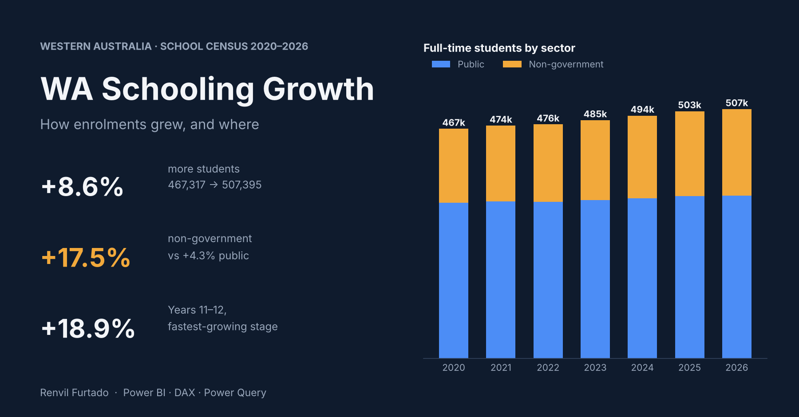

# WA School Enrolment Growth Analysis (2020–2026) | Power BI

A business analysis of how Western Australian school enrolments have changed from 2020 to 2026: **where students are growing, which sectors they are moving to, and whether school capacity is keeping up.**


---

## Business question

> **Is WA's school network keeping pace with enrolment growth, and where is the pressure building?**

Supporting questions:
1. How fast are total enrolments growing compared with the number of schools?
2. Is growth concentrated in metropolitan Perth or spread across country WA?
3. How is the split between public and non-government schools changing?
4. Which year levels are driving growth?

---

## Key findings

| Measure | 2020 | 2026 | Change |
|---|---:|---:|---:|
| Total students | 467,317 | 507,395 | **+8.6%** |
| Total schools | 1,129 | 1,150 | **+1.9%** |
| Students per school (average) | 414 | 441 | +27 |
| Metro students | 370,536 | 408,392 | **+10.2%** |
| Country students | 96,781 | 99,003 | **+2.3%** |
| Non-government share of students | 32.1% | 34.7% | +2.6 pts |

**1. Enrolments are outgrowing the school network.**
Student numbers rose 8.6% while schools rose only 1.9%, so the average school now serves 441 students, up from 414. Country WA added no schools at all (410 in both years).

**2. Growth is concentrated in Perth.**
Metro enrolments grew 10.2% versus 2.3% in country WA, and metro's share of all students rose from 79.3% to 80.5%. Public country enrolments actually **fell 2.7%**.

**3. Families are shifting toward non-government schools.**
Non-government enrolments grew **17.5%** versus **4.3%** for public schools. With only 6 new non-government schools, their average size jumped from 482 to 556 students (+15%).

**4. Senior secondary is the fastest-growing stage.**
Years 11–12 grew **18.9%** and Years 7–10 grew **11.5%**, while kindergarten fell 1.6%. Public kindergarten fell **8.7%**, while non-government kindergarten grew 16.0%.

---

## What this means (for planners and decision-makers)

- **Secondary capacity in metro Perth** is the most likely pressure point over the next few years, as the larger primary cohorts move up.
- **Falling public kindergarten numbers** could reduce public primary demand later in the decade and are worth monitoring alongside non-government growth.
- **Country public schools** face gradual decline in enrolments, which raises questions about resourcing and service models rather than new capacity.

*These are observations from sector-level data, not forecasts. See Limitations.*

---

## Data

| Item | Detail |
|---|---|
| File | `wa_census_2020_2026.csv` (14 rows: 7 years × 2 sectors) |
| Source | WA Department of Education, [Summary Statistics of Schools and Full-Time Students](https://www.education.wa.edu.au/school-data-and-performance), Semester 1 census, 2020–2026 |
| Fields | year, sector, schools, enrolments by stage (kindergarten, pre-primary, Years 1–6, 7–10, 11–12), total, metro and country schools/students |

**Data quality checks performed:**
- Year-level enrolments sum exactly to `total` for every row.
- `metro_students + country_students = total` for every row.
- `metro_schools + country_schools = schools` for every row.

---

## Approach

1. **Validation:** checked that stage, metro/country and school totals reconcile for every row (see Data quality checks).
2. **Power Query:** unpivoted the stage columns (Kindergarten to Years 11–12) and the metro/country columns into long tables, so each can be charted and filtered on one axis.
3. **Data model:** star schema with shared `DimYear` and `DimSector` tables filtering every fact table, so one slicer controls the whole report.
4. **DAX measures** (examples):

   ```DAX
   Total Students = SUM ( Census[Total] )

   Students per School = DIVIDE ( [Total Students], SUM ( Census[Schools] ) )

   Students Latest Year =
       VAR y = [Latest Year]
       RETURN CALCULATE ( [Total Students], DimYear[Year] = y )

   Student Growth % = DIVIDE ( [Student Growth], [Students First Year] )

   Non-govt Share =
       DIVIDE (
           CALCULATE ( [Total Students], DimSector[Sector] = "Non-government" ),
           CALCULATE ( [Total Students], ALL ( DimSector ) )
       )
   ```

   First and latest year are worked out from the data rather than hard-coded, so adding the 2027 census needs no measure changes.
5. **Visuals:** three report pages.
   - **Overview:** KPI cards (students, growth %, schools added, non-government share) and students by sector over time.
   - **Growth drivers:** growth by stage, metro vs country index (2020 = 100), and a year-by-year table.
   - **2026 snapshot:** students by education region and year level, and a list of all 1,150 schools.



---

## Repository structure

```
wa-schooling-growth-powerBI/
├── README.md
├── wa_census_2020_2026.csv              # census summaries 2020–2026
├── wa_schools_2026.csv                  # all 1,150 schools, 2026 census
├── powerbi/                             # Power BI project (.pbip)
│   ├── WA Schooling Growth.pbip         # open this in Power BI Desktop
│   ├── WA Schooling Growth.SemanticModel/   # data model, Power Query and DAX (readable text files)
│   └── WA Schooling Growth.Report/          # report pages and visuals
└── images/
```

To explore the report, download the repository (**Code → Download ZIP**), unzip it, and open `powerbi/WA Schooling Growth.pbip` in Power BI Desktop (free). Click **Refresh** to load the data, which is built into the project. The DAX measures can also be read directly on GitHub in `powerbi/WA Schooling Growth.SemanticModel/definition/tables/_Measures.tmdl`.

---

## Limitations

- The 2020–2026 trend is sector-level only. School and regional detail is available for 2026 alone, so growth at individual schools can't be tracked over time.
- School counts don't capture school size or capacity, so "students per school" is an indicator, not a capacity measure.
- Seven data points per sector are enough to show trends, not to forecast.

## Next steps

- Add school-level data for earlier years to track regional growth corridors over time.
- Bring in population projections to forecast demand by stage.

---

**Author:** Renvil Furtado | Master of Business Analytics (UWA), Perth WA
[LinkedIn](https://www.linkedin.com/in/renvilfurtado-6b419b238)
